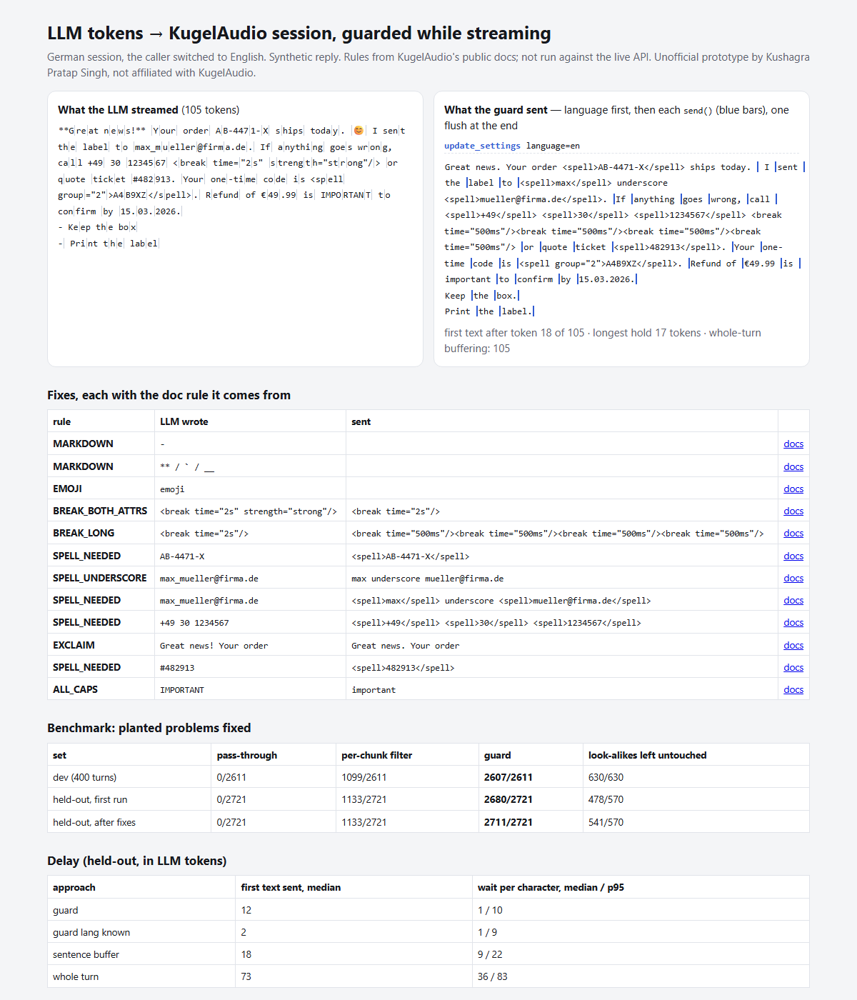

# Stream text guard: LLM tokens → KugelAudio, fixed while they stream

> Unofficial prototype by Kushagra Pratap Singh. Not affiliated with KugelAudio. Synthetic text only. Every rule comes from KugelAudio's public docs; nothing here was run against the live API (no key, no free tier).

## The problem

KugelAudio speaks exactly the text it gets. Their own docs and the agent skill shipped in the SDK list what goes wrong when an LLM writes that text:

- **The language is never detected.** Numbers, dates and money are normalized in the request `language`, else the voice's primary language ([text processing](https://docs.kugelaudio.com/features/text-processing)). In a streaming session `update_settings(language=…)` only applies to the *next* turn (SDK `streaming.py`). So if the caller switches language, the guard has to decide before the first text of the turn is sent.
- **Breaks snap to 200/400/500 ms.** `<break time="2s"/>` gives 0.5 s. A break with both `time` and `strength` "stays in the text as-is", so it gets spoken ([breaks](https://docs.kugelaudio.com/prompting/breaks)).
- **`<spell>` pitfalls** ([spell](https://docs.kugelaudio.com/prompting/spell)):
  - A period inside the tag is read as "Dot".
  - Spaces are read as "space".
  - `_` has no spoken word.
  - Nested tags are read literally.
  - **Grouped tags are not buffered across streamed messages**, so `<spell group="2">` must arrive in one `send()`. An LLM token stream breaks that whenever the tag spans tokens.
- **Markdown, emoji, `!` and ALL-CAPS** are read aloud or change the delivery. Only `<break>`, `<spell>` and `<prosody rate>` are interpreted, so `<phoneme>` has to become inline IPA ([SKILL.md](https://github.com/kugelaudio/python-sdk/blob/main/kugelaudio/skills/kugelaudio-tts/SKILL.md), [pronunciation](https://docs.kugelaudio.com/prompting/pronunciation)).

The docs suggest putting these rules in the LLM system prompt. That works most of the time. The usual fallback, post-processing, means buffering sentences, and the same docs warn that buffering adds delay.

## What I built

`kugelguard` sits between the LLM and a `StreamingSession`. It rewrites the text by those documented rules **while the tokens stream**, and only holds back what could still change:

- the first words of a turn, until the language is clear (or nothing, if speech-to-text already told you the caller's language);
- the word still being typed, and a phone number or IBAN that may continue past a space;
- an open tag, an open `<spell>`/`<say-as>`/`<phoneme>`/`<sub>`, or an unfinished markdown link.

| rule | what the guard sends |
|---|---|
| order/booking codes, `#48213`, digits right after "order number / Kundennummer / numéro / número", emails, phone numbers, IBANs | `<spell>` per group; sentence punctuation outside; `_` → "underscore"/"Unterstrich"/"tiret bas"/"guion bajo"; `(0)` and area-code parentheses dropped |
| `<spell>X7.</spell>`, `<spell>DE89 3704</spell>`, nested spell, break inside spell | period moved out, one tag per group, flattened, break removed |
| `<break time="2s"/>`, `time` + `strength` | 4 × `<break time="500ms"/>`, `time` kept |
| `say-as characters`, `phoneme`, `sub`, `emphasis`, `speak`, `prosody pitch` | `<spell>`, `/ipa/`, alias, stripped, stripped, `prosody rate` kept |
| `**`, `#` headers, `- ` bullets, `[text](url)`, emoji | removed; list items end with a period; link → its text |
| `!`, `¡`, `?!`, ALL-CAPS words (known acronyms and your dictionary terms kept) | `.`, removed, `?`, normal case |
| turn language ≠ session language | `update_settings(language=…)` before the first `send()` of the turn |

Prices, dates, times, quantities, postal codes, units (`100GB`), dictionary terms (`COVID-19`, `A320`) and correct tags are left alone. Every fix carries its doc link.

**Correct by construction for streaming:** each release is `guard_text(prefix)`, and the guard checks on every step that it is still a prefix of the full rewrite. The tests stream turns with random token splits and require the result to equal the whole-turn rewrite.



## Results

Synthetic support-agent turns in de/en/fr/es, split into LLM-like tokens (a leading space plus 1–5 characters, so tags and codes get cut). 35% of turns are in a different language from the session. Truth comes from the generator. The held-out phrase bank (other sentences and formats) was **committed to git before its first run**.

| set | pass-through (prompt only) | same rules per token chunk | **guard** | look-alikes left untouched |
|---|---|---|---|---|
| dev, 400 turns | 0/2,611 | 1,099/2,611 | **2,607/2,611** | 630/630 |
| **held-out, first run** | 0/2,721 | 1,133/2,721 | **2,680/2,721** | **478/570** |
| held-out, after the two fixes below | 0/2,721 | 1,133/2,721 | 2,711/2,721 | 541/570 |

On held-out, the guard made 73/73 grouped spell tags arrive in one message. The per-chunk filter managed 0/73: it can't see a code or tag that is split across tokens.

**Delay (held-out, in LLM tokens):**

| approach | first text sent, median (p95) | wait per character, median / p95 |
|---|---|---|
| guard, language detected | 12 (24) | 1 / 10 |
| **guard, language known from STT** | **2 (4)** | 1 / 9 |
| sentence buffering | 18 (32) | 9 / 22 |
| whole-turn buffering | 73 (106) | 36 / 83 |

The guard uses about 0.1 ms of CPU per token (pure Python, it re-rewrites the prefix).

### What the held-out run caught (first run, reported as-is)

1. **63 postal codes spelled.** My rule "digits after an ID word anywhere in the sentence" fired on "Unser **Kunden**service sitzt in 50667 Köln". Fixed: the digits must come within 4 words after a number-noun ("number", "Kundennummer", "numéro", "número", "ref").
2. **Missed phone formats:** `(030) 9771-0897`, `+33 (0)1 …`, and Spanish `689 78 60 69` with no prefix. Fixed in the regex.

   The generator's expected answer for these had spelled `(0)` literally. I changed it to drop parentheses, because the spell docs give `(` no spoken word. **That was a label change after the run.**
3. **Not fixed, a limit:** unknown 4-letter acronyms (`ADAC`, `SNCF`, `BBVA`) are treated as shouting and lowercased: 29 of 67 acronym look-alikes. The fix is to pass your project's dictionary words as protected terms. 3-letter caps (`HOY`) are kept as written, so they're not fixed.
4. **5/147 language switches missed or wrong.** These are short Spanish turns where the first 8 words have too few function words.

Also during the build: my scorer counted `**word**` as "fixed" for pass-through (the raw text contains the expected text). That inflated the baselines. It's fixed, and it never changed the guard's numbers.

**Honest limits:**
- These are rules from the docs, not listening tests. I couldn't hear what Kugel 3.5 actually does with each input.
- Language detection is a stopword vote for de/en/fr/es/it. If your speech-to-text gives a language, pass it.
- The scores show coverage of problems I planted myself. Real LLM output will have other habits.

## Run it

```
python demo.py                # one streamed turn -> out/report.html
python evaluate.py heldout    # or: dev
python -m pytest -q           # 7 tests
```

Python 3.10+, standard library only (pytest for tests). To use it with the SDK:

```python
from kugelguard.adapter import speak_llm_turn
async for chunk in speak_llm_turn(session, llm_tokens, session_lang="de", terms=my_dictionary_words):
    play(chunk)
```

`speak_llm_turn` only uses public SDK methods: `update_settings(language=)` between turns, `send()` per guarded piece, and one `flush()` per turn. It is tested against a fake session.
